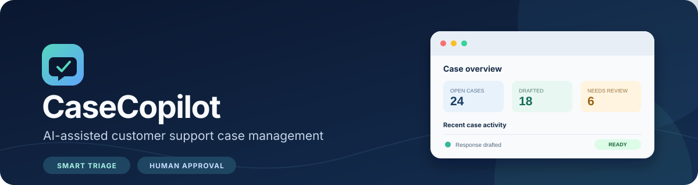
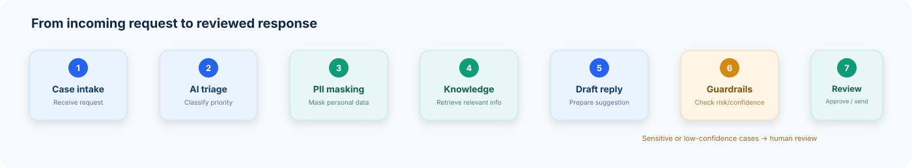

# CaseCopilot

<p align="center">
  
</p>

<p align="center">
  <a href="https://casecopilot.onrender.com">
    
  </a>
</p>

<p align="center">
  
  
  
  
  
  
</p>

An AI-powered customer support case management application. CaseCopilot automatically triages incoming support cases, identifies priority, searches a knowledge base, drafts customer responses and escalates sensitive or low-confidence cases for human review.

It combines automated support workflows with human approval, helping teams handle customer requests more efficiently without losing control over important decisions.

## Try it in 30 seconds

Open the **[CaseCopilot live demo](https://casecopilot.onrender.com/)**.

The free server may take some time to wake up on the first visit.

| Account | Password | Role |
|---|---|---|
| `meera` | `demo123` | Manager |
| `asha` | `demo123` | Rep |
| `ravi` | `demo123` | Rep |

1. Sign in using one of the demo accounts.
2. Create a new customer support case with a subject and message.
3. Run the agent to analyze and triage the case.
4. Review the generated response, priority and escalation decision.
5. Sign in as the manager to review and approve cases requiring human authorization.

## Case lifecycle

<p align="center">
  
</p>

A case moves through the following statuses:

| Status | Description |
|---|---|
| New | A customer support case has been created |
| Drafted | The agent has prepared a suggested response |
| Escalated | The case requires human attention |
| Sent | The response has been approved |

## Features

| Area | What it does |
|---|---|
| Case management | Create and manage customer support cases |
| AI-powered triage | Analyze incoming messages and determine case priority |
| Knowledge base | Search five local support articles for relevant information |
| Response drafting | Generate suggested customer responses using knowledge base information |
| Smart escalation | Escalate sensitive or low-confidence cases for human review |
| PII protection | Mask personally identifiable information using regex-based processing |
| Human approval | Require manager authorization before approving responses |
| Dashboard analytics | Track total cases, auto-draft rate, escalations and sent responses |
| Input validation | Validate API requests using Pydantic |
| Demo environment | Seed sample cases using an environment variable |

## Agent workflow

1. **Case intake:** Receive a customer support request containing customer information, subject and message.
2. **Priority detection:** Analyze the request and determine its priority.
3. **PII masking:** Identify and mask supported personally identifiable information.
4. **Knowledge retrieval:** Search the local knowledge base for relevant support information.
5. **Response generation:** Prepare a suggested reply based on the case and available knowledge.
6. **Guardrail evaluation:** Identify sensitive or low-confidence cases that require human intervention.
7. **Human approval:** Allow a manager to review and approve cases requiring authorization.

## Security and reliability

- **PII masking:** Regex-based processing helps prevent supported personal information from being unnecessarily exposed during case processing.
- **Human-in-the-loop:** Manager approval provides an authorization checkpoint before a response is marked as sent.
- **Server-side authorization:** Approval permissions are enforced through the backend.
- **Input validation:** Pydantic validates incoming request data.
- **Persistent storage:** SQLite stores case information.
- **Controlled workflow:** Cases follow defined statuses instead of allowing arbitrary status changes.

## Quality

- **14 automated tests passing.**
- **100% code coverage (136/136 statements).**
- Tests cover authentication, case creation, agent execution, PII masking, manager approval, dashboard statistics, homepage and demo data seeding.
- Backend modules `app/main.py` and `app/auth.py` achieved 100% coverage.
- Automated testing uses pytest and pytest-cov.

## API

Interactive API documentation is available at `/docs` on the deployed application.

| Method | Path | Purpose |
|---|---|---|
| GET | `/` | Serve the application homepage |
| GET | `/api/cases` | Retrieve support cases |
| POST | `/api/cases` | Create a new support case |
| POST | `/api/cases/{cid}/run` | Run the triage agent on a case |
| POST | `/api/cases/{cid}/approve` | Approve a case (manager only) |
| GET | `/api/stats` | Retrieve dashboard statistics |

## Design decisions

- **Human approval over blind automation:** Sensitive or low-confidence cases are escalated instead of automatically progressing without review.
- **Knowledge-based responses:** The agent uses a local knowledge base to ground suggested customer replies in available support information.
- **PII-aware processing:** Personal information is masked using regex-based rules.
- **Clear case lifecycle:** Explicit statuses make it easier to track the progress of every support request.
- **Backend authorization:** Manager approval restrictions are enforced by the API rather than relying only on frontend controls.
- **Persistent storage:** SQLite provides a lightweight database without requiring a separate database server.

## Tech stack

Python 3.12, FastAPI, SQLite, Pydantic, pytest, pytest-cov, vanilla JavaScript, HTML, CSS, regex-based PII masking and Render.

## Run locally

Clone the repository:

```bash
git clone https://github.com/shaikumar11/CaseCopilot.git
cd CaseCopilot
```

Install dependencies:

```bash
pip install -r requirements.txt
```

Start the application:

```bash
python -m uvicorn app.main:app --reload
```

Run automated tests:

```bash
python -m pytest --cov=app --cov-report=term-missing
```

Open the application at:

`http://127.0.0.1:8000`

## Configuration

| Variable | Purpose |
|---|---|
| `DB_PATH` | SQLite database location (defaults to `cases.db`) |
| `SEED_DEMO` | Set to `1` to initialize sample support cases |

## Built by

**Shaik Mohammed Umar**

[LinkedIn](https://linkedin.com/in/mohammed-umarshaik) · [GitHub](https://github.com/shaikumar11) · umarshaikno1@gmail.com

